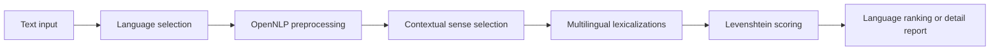

<p align="center">
  
</p>

<p align="center">

  <strong>Normalized Natural-language Orthographic Index of Similarity</strong><br>
  A multilingual orthographic transparency analysis tool<br>
  <strong>Version 0.2.0</strong> · <a href="CHANGELOG.md">Changelog</a>

</p>

### The Engine

**N**ormalized **N**atural-language **O**rthographic **I**ndex of **S**imilarity

Nnois compares a source-language word, or the nominal content of a text, with lexicalizations of the same concept in other languages. It combines language detection, OpenNLP preprocessing, contextual sense disambiguation, multilingual lexical data, and normalized Levenshtein similarity to estimate **orthographic transparency across languages**.

### The Promise

> **Nnois: No Isolation in Language.**

Nnois is designed around a simple idea: linguistic distance should not have to mean social distance. By revealing recognizable forms and lexical similarities across languages, Nnois can help learners discover connections between what they already know and what they are learning.

### The Name

Pronounced **/nɔɪz/** — *noise*.

The name deliberately evokes the apparent noise of an unfamiliar language: unfamiliar words, unfamiliar spellings, and unfamiliar forms. Nnois turns that apparent noise into measurable patterns of similarity.

The current wordmark uses interwoven orthographic signals converging on a shared meaning. The original [VHS artwork](Nnois_VHS.png) remains part of the project archive and is preserved alongside the new identity.

**From unfamiliar words to recognizable patterns.  
From recognizable patterns to understanding.  
From understanding to connection.**

> Nnois measures **orthographic similarity**, not proven etymological relatedness. A high score indicates similar written forms for entries representing the same selected sense; it does not establish that the forms are historical cognates.

## Highlights

- Analyze a word in context and compare its selected sense across languages.
- Analyze multi-word input automatically through nouns and validated noun phrases.
- Explore all available senses and translations for a single word.
- Rank deterministic same-language alternatives from the selected OMW synset by greater or lower transparency to a comparison language.
- Modify a complete text toward a chosen transparency level without mixing languages.
- Disambiguate English and multilingual context locally through Java and ONNX Runtime.
- Optionally validate proposed replacements with a local decoder that cannot invent replacement text.
- Select the source language automatically or manually with ISO 639-1/ISO 639-2 codes.
- View aggregate language rankings or an optional unit-by-unit report.
- Read language output in terminal colors inspired by associated national flags.

## What It Can Be Used For

- **Contrastive linguistics:** explore how words that express a selected sense differ in written form across languages.
- **Lexical-semantic research:** inspect context-sensitive sense selection and the lexicalizations attached to the selected concept.
- **Vocabulary exploration:** use the single-word sense explorer to examine definitions, near-equivalent forms, and multilingual lexical alternatives.
- **Second-language acquisition:** identify familiar-looking vocabulary between a learner's known language and a target language, then use the contextual analysis to discuss when apparent form similarity aligns with meaning.
- **Language-learning material design:** inspect a text's nominal vocabulary and use the aggregate detail report to select cross-linguistic comparison examples for a lesson or activity.
- **Corpus and text exploration:** obtain a compact, language-by-language orthographic profile of the nominal content of a short text.

For second-language acquisition, Nnois is most useful as a prompt for guided comparison: learners can test hypotheses about form and meaning, notice spelling correspondences, and investigate false friends. Its scores do not measure word frequency, pronunciation, grammatical difficulty, communicative usefulness, or whether an apparent similarity has a shared historical origin.

## Requirements

- Java 21 or a compatible JDK
- Maven 3.8+
- Python 3.9+ for the project helper and database builder; Git for downloading OMW data
- Multilingual lexical SQLite data at `nnois/src/main/resources/omw/omw_multilingual.db`
- Local ONNX model assets for contextual sense selection; model files are intentionally excluded from Git and release archives

Language-specific OpenNLP models improve tokenization, POS tagging, noun-phrase extraction, and lemmatization. The Maven configuration includes models for English, Italian, German, French, Spanish, Portuguese, and Dutch; the application falls back where models are unavailable.

## Quick Start

See [INSTALL.md](INSTALL.md) for prerequisites, platform notes, and troubleshooting.

From the project root on Windows:

```powershell
.\nnois.cmd
```

This handles first-time setup automatically: download missing OMW data, build and check the database, install its attribution, compile Java, and start the CLI. Later runs reuse the database. Requires Python, JDK 21, Maven, and Git for downloads. Normal startup does not run tests.

On any platform, the equivalent command is:

```bash
python nnois.py
```

To rebuild only the database, or use an existing OMW checkout:

```bash
python nnois.py build-db
python nnois.py build-db --data-dir /path/to/omw-data
```

If Maven is installed outside `PATH`, supply `--maven "C:\path\to\maven\bin\mvn.cmd"`. The helper works independently of the current directory. It supports both `wns/` and `omw/` source layouts and builds in a staging directory before replacing the installed database.

To compile and run manually once the database is installed:

```bash
cd nnois
mvn clean package
mvn exec:java -Dexec.mainClass=com.nnois.App
```

You can also run `com.nnois.App` directly from an IDE after marking `src/main/resources` as a resources root.

## Using The CLI

### Analysis modes

The Java CLI exposes four analysis modes. Whole-text comparison measures a text against OMW lexicalizations; one-word analysis selects a contextual occurrence; word alternatives builds a deterministic replacement scale; and the automatic modifier applies only decoder-approved candidates across a text.

Type `demo` at the Java app's `Text >` prompt, then press Enter for all seven languages or choose one. You can also type `demo it` directly. The demo returns to the text prompt when finished; `back` cancels the language selection. The passages, demo runner, detection, analysis, and rendering are implemented in Java. Python is an optional setup and launch helper.

Run `python nnois.py demo` for a noninteractive demonstration of English, Italian, French, German, Spanish, Portuguese, and Dutch. Use `python nnois.py demo --language it` for one language. Each substantial parallel passage shows the detected language, nominal coverage, leading translation scores, and a contextual OMW sense for the local word for river. A final summary compares the languages. The demo reuses the installed database and uses the detected language for analysis. Read the passages in [DEMO_TEXTS.md](DEMO_TEXTS.md). The examples demonstrate functionality; they are not an accuracy benchmark.

Enter text at `Text >`. Nnois suggests a language before analysis: press Enter to accept it, or type a language name, two-letter code, or three-letter code. Supported NLP languages are English, Italian, French, German, Spanish, Portuguese, and Dutch.

```text
Text > The children are reading a book in the garden.
Suggested  English (eng) | model score 0.065
Language [Enter = suggested] >

  1  Whole-text comparison (default)
  2  One word in context
  3  Word alternatives
  4  Automatic text modifier
Mode [1] >
```

Press Enter for whole-text comparison. Choose `2` for a specific content word, `3` to inspect alternatives for one occurrence, or `4` to modify eligible words throughout the text. Modes 3 and 4 ask for a comparison language and whether the result should be more or less orthographically similar. Replacements always remain in the detected or selected source language. Invalid targets and stopwords prompt you to try again. A single-word input opens the OMW sense explorer directly.

The main report uses aligned columns and score bars, showing up to 12 results initially. You can request the remaining results and word-by-word details. The sense explorer displays three senses at a time and groups translations by language. Long translations are abbreviated to keep the table readable.

Commands:

- `demo`: run the built-in Java demo; `demo it` selects one language.
- `help`: show available actions at the text prompt.
- `paste`: enter multiple lines; finish with a single `.` on its own line.
- `back`: cancel language or analysis-mode selection; at the target prompt, return to mode selection.
- `exit` or `quit`: finish the session.

Analysis errors return to text entry instead of closing the application. The original red/cyan banner is displayed at startup. Headings, menus, languages, and scores use distinct colors; tables retain alignment. Color is enabled for an interactive console; `NO_COLOR` disables it. Redirected output uses plain text by default. Set `$env:FORCE_COLOR = "1"` in PowerShell to enable colors in an IDE or terminal where console detection fails (`NO_COLOR` takes precedence).

### Language detection

The shared OpenNLP detector normalizes Unicode and removes URLs, email addresses, and control characters before prediction. It retains the original text for lexical analysis. Language aliases are normalized consistently before OMW lookup.

Short inputs (fewer than four words), weak scores, and closely ranked candidates show the top three alternatives. Uncertainty uses a top-to-runner-up ratio below 1.5 or a top score below 0.02; these are conservative heuristics, not calibrated correctness probabilities. Sentence-level checks also flag passages with differing strong language predictions (up to 16 substantial sentences). Mixed-language detection is a warning heuristic and may miss switches within a sentence. Analyze languages separately for the best results.

The displayed model score is not the probability that the language is correct. Unsupported predictions require a manual supported-language choice, rather than silently analyzing with missing NLP models. Single words often need a manual language override.

## Understanding Scores

### Individual Token Scores

For source form $s$ and target lemma $t$, Nnois calculates normalized Levenshtein similarity:

$$
T(s,t) = 1 - \frac{d(s,t)}{\max(|s|, |t|)}
$$

where $d(s,t)$ is the edit distance between normalized forms. Individual scores range from `0.00` to `1.00`:

| Score | Meaning |
| ---: | --- |
| `1.00` | Identical normalized forms |
| `0.90–0.99` | Very similar; minor spelling differences |
| `0.70–0.89` | Recognizable; clear orthographic overlap |
| `0.50–0.69` | Partial similarity; some character correspondence |
| `0.20–0.49` | Weak similarity; limited overlap |
| `0.00–0.19` | Minimal similarity; few shared characters |

### Aggregate Scores

The total nominal coverage score is **considered word occurrences / all non-stopword word occurrences**, with a range of `0.00` to `1.00`. Repeated words count separately; validated phrases count their constituent words once. Empty texts and texts containing only stopwords return zero. This measures nominal coverage, rather than a validated measure of human reading difficulty.

Per-language transparency scores are **normalized by the number of extracted units**, including units with no OMW match as zero contributions:

$$
A_{\ell}(X) = \frac{1}{n} \sum_{u \in U(X)} T(u, t_{u,\ell})
$$

where $n$ is the count of extracted nominal units and $t_{u,\ell}$ is the lexicalization with the highest transparency in language $\ell$. Multiple synonyms for one sense contribute only their maximum score, and missing translations contribute zero. This produces a **0.00 to 1.00 range** comparable to single-token scores.

**Example:** A text with 4 analyzed units where Italian contributes scores of 0.80, 0.60, 0.50, and 0.40 yields:
$$A_{ita} = \frac{0.80 + 0.60 + 0.50 + 0.40}{4} = 0.575$$

The optional detailed report shows individual unit contributions so you can trace back which nominal elements drove the aggregate ranking.

### How to Read Scores

- **Use individual scores** to identify potentially cognate-like forms or to notice spelling correspondences for vocabulary learning.
- **Compare aggregate scores** to see which languages have the most recognizable nominal vocabulary in a given text.
- **Inspect the detailed report** to understand which concepts (nouns and noun phrases) account for high or low aggregate scores in each language.
- **Do not assume high scores indicate translation quality, pronunciation similarity, or historical relatedness.** Nnois measures visible orthographic form under a shared sense constraint.

### Levenshtein Distance Calculation

The edit distance is computed by dynamic programming. For prefixes of source form $s$ and target form $t$, the recurrence is:

$$
D(i,j) = \min\begin{cases}
D(i-1,j) + 1 & \text{deletion} \\
D(i,j-1) + 1 & \text{insertion} \\
D(i-1,j-1) + [s_i \ne t_j] & \text{substitution}
\end{cases}
$$

with $d(s,t) = D(|s|, |t|)$. Before this calculation, the implementation lowercases and trims both forms. It therefore measures visible similarity in the normalized spelling, rather than pronunciation or morphology in the abstract.

## Linguistic Method

Nnois is a contrastive lexical-analysis tool. It first determines which linguistic unit is being compared, then measures how similar its written form is to lexicalizations of the same meaning in other languages.

### From Text To Lexical Unit

- **Tokenization** separates the input into word-like units.
- **Part-of-speech tagging** distinguishes likely nouns, verbs, adjectives, and adverbs. In aggregate mode, nouns and proper nouns are the primary evidence-bearing units.
- **Lemmatization** reduces inflected forms to a dictionary form when a language model is available. This limits superficial differences such as number or verbal inflection.
- **Noun-phrase chunking** detects multi-word nominal expressions. A phrase is retained as one unit only when it is attested in the lexical data; otherwise its component nouns remain separate.

### Sense In Context

Many word forms are polysemous: the same spelling can represent several meanings. Nnois scores the complete occurrence context against the glosses of candidate OMW senses and accepts a sense only when both its score and its margin over the runner-up satisfy deterministic thresholds. The selected synset supplies the shared lexical concept used for comparison and substitution.

### Local model for OMW sense selection

Nnois runs contextual sense selection locally in Java through ONNX Runtime. It uses [ChangeIsKey/graded-wsd](https://huggingface.co/ChangeIsKey/graded-wsd) for English context and [intfloat/multilingual-e5-small](https://huggingface.co/intfloat/multilingual-e5-small) for Italian, French, German, Spanish, Portuguese, and Dutch. Place the exported assets in these default directories:

```text
models/
|-- graded-wsd/
|   |-- model.onnx
|   |-- tokenizer.json
|   `-- config.json
`-- multilingual-e5-small/
    |-- model.onnx
    |-- tokenizer.json
    `-- config.json
```

Use `NNOIS_WSD_MODEL_DIR` and `NNOIS_MULTILINGUAL_WSD_MODEL_DIR` to override those paths. Both directories are resolved from the repository root by default. Model binaries are not committed or distributed with Nnois; obtain them separately and review their licenses before use.

The English acceptance defaults are `nnois.wsd.threshold=2.5` and `nnois.wsd.margin=0.25`. The multilingual defaults are `nnois.multilingual.wsd.threshold=0.65` and `nnois.multilingual.wsd.margin=0.01`. They can be overridden as JVM system properties for evaluation, but a release should keep them fixed for reproducibility. A missing model or an inconclusive result is reported explicitly; Nnois does not silently turn an uncertain sense into a substitution.

### Deterministic substitutions and optional validation

After selecting a sense, Nnois obtains replacement candidates only from source-language lexicalizations in that same OMW synset. It measures each candidate against the comparison-language lexicalization with normalized Levenshtein similarity, then applies a stable ordering and deterministic tie-breaks. The comparison language controls the transparency target; it never becomes the output language.

For automatic rewriting, an optional local [Qwen2.5-1.5B-Instruct](https://huggingface.co/Qwen/Qwen2.5-1.5B-Instruct) ONNX decoder checks the cohesion of each already-selected candidate in context. It returns only `accepted`, `rejected`, or `unverified`; it does not generate prose or replacement words. Unverified candidates are not applied. Set `NNOIS_SUBSTITUTION_MODEL_DIR` and `NNOIS_SUBSTITUTION_PYTHON` if the model and its isolated Python runtime are outside the default `models/substitution-decoder-onnx` and `.venv-decoder` paths. The core analysis and candidate generation remain Java-based and deterministic.

### Reading Across Languages

Once a sense $\sigma^*$ has been selected, Nnois retrieves its lexicalizations in each destination language $\ell$. It does not compare every word in one language against every word in another. Instead, it compares forms only after they have been associated with the same selected concept:

$$
K(\sigma^{}, \ell) = {t \mid t \text{ lexicalizes } \sigma^{} \text{ in language } \ell}
$$

Each candidate form $t \in K(\sigma^*,\ell)$ receives $T(w,t)$. The ranked result is therefore a **cross-linguistic reading of orthographic form under a shared sense constraint**. It can highlight visibly similar lexicalizations, including potential cognate-like forms, but it cannot distinguish inherited cognates, borrowings, chance resemblance, transliteration effects, or language-specific spelling conventions.

For aggregate nominal analysis, the language profile is the normalized sum of unit-level scores:

$$
A_{\ell}(X) = \frac{1}{n} \sum_{u \in U(X)} T(u, t_{u,\ell})
$$

where $t_{u,\ell}$ is a lexicalization linked to the sense selected for unit $u$. The detailed report exposes these individual contributions so that a language-level total can be read back through its nominal evidence.

### Weighted Extended Lesk

The local WordNet analysis pathway also implements a weighted extended Lesk variant. Its sense signature combines direct-gloss terms, hypernym and hyponym glosses, and verb-frame examples. For a context-term frequency $f_C(x)$ and a signature weight $W_\sigma(x)$, it calculates:

$$
L_w(\sigma, C) = \sum_{x \in C} f_C(x) \cdot W_\sigma(x)
$$

The current weights are `2.0` for direct gloss terms, `1.0` for hypernym and hyponym glosses, and `1.5` for verb-frame examples. Ties are resolved by direct-gloss matches, the WordNet sense number, then the synset identifier. This pathway preserves repeated context terms through $f_C(x)$, whereas the native multilingual path uses set overlap.

`JwiLeskDisambiguator` uses the bundled English OpenNLP tokenizer, POS tagger, and statistical lemmatizer to process both context and signatures. It retains nouns, verbs, adjectives, and adverbs based on predicted POS, rather than a fixed stopword vocabulary or word-length cutoff. POS-aware WordNet stemming normalizes the resulting lemmas. This pathway requires an explicit target POS and English context, because Princeton WordNet glosses are English. Replacement classpath models can be supplied through `LeskNlp` and the two-argument disambiguator constructor; missing models produce an explicit loading error. The native multilingual disambiguator remains a separate pathway.

Model tests run with `mvn test`. To also run the optional WordNet integration test, use `mvn test -Dwordnet.dict=/path/to/wordnet/dict`.

The result should be read as a context-sensitive comparison of lexical forms. It is not a translation-quality judgment, a measure of phonetic similarity, or an etymological classifier.

## Processing Pipeline



1. The application detects or accepts the source language.
2. OpenNLP tokenizes, tags, and lemmatizes the text when corresponding models are available.
3. For contextual analysis, a Lesk-style disambiguator chooses the best lexical sense.
4. Aggregate mode identifies nominal tokens and validated noun phrases, then repeats the analysis for each unit.
5. Lemmas linked to the selected sense are scored and ranked by language.

## Supported Language Codes

The pipeline normalizes common ISO 639-2 codes for OpenNLP while resolving the final source language against the available lexical data.

| ISO 639-2 | ISO 639-1 |
| --- | --- |
| `eng` | `en` |
| `ita` | `it` |
| `fra` | `fr` |
| `deu` | `de` |
| `spa` | `es` |
| `por` | `pt` |
| `nld` | `nl` |

Use automatic detection for ordinary text and manual selection when working with short, mixed-language, or ambiguous input.

## Building the OMW Database

The multilingual lexical database is created from the [Open Multilingual Wordnet (OMW)](https://github.com/omwn/omw-data) project. To build `omw_multilingual.db` from source:

```bash
# Run from the project root; installs the DB and attribution together
python nnois.py build-db
```

The builder is `omw-database/create_db.py` (Python with standard-library SQLite), not a Maven module. See the `omw-database/README.md` for standalone usage and schema information.

## Project Layout

```text
Nnois/
├── nnois/              Java/Maven application
│   ├── src/main/java/  CLI, NLP, disambiguation, and scoring
│   └── src/main/resources/omw/
│                       Generated OMW database and attribution
├── models/             Local model assets, excluded from Git
├── omw-database/       Database creation utility
└── tests/              Python helper tests
```

## Troubleshooting

| Problem | What to check |
| --- | --- |
| Database cannot be found | Confirm that `omw_multilingual.db` is present under `src/main/resources/omw/`. |
| Language detection is unreliable | Use a longer input or select a source language manually. |
| No senses are returned | Check the source lemma, selected language code, and the `synset_lemmas` lexical-data table. |
| Contextual model cannot be loaded | Check the model files and set `NNOIS_WSD_MODEL_DIR` or `NNOIS_MULTILINGUAL_WSD_MODEL_DIR`. |
| Automatic modifier applies no changes | Install the optional decoder and Python runtime, or inspect candidates in mode 3. Unverified candidates are intentionally not applied. |
| No nominal units are detected | Verify that the tokenizer and POS model for the source language are available. |
| Colors render as text | Run the CLI in an ANSI-compatible terminal. |

## Attributions

Nnois depends on open lexical resources, models, and libraries. See [ATTRIBUTIONS.md](ATTRIBUTIONS.md) for the complete resource, model, and software credits.

Key resources:

- **Open Multilingual Wordnet (OMW):** https://github.com/omwn/omw-data ([OMW License](https://github.com/omwn/omw-data/blob/master/LICENSE))
- **Apache OpenNLP:** https://opennlp.apache.org/ ([Apache License 2.0](https://www.apache.org/licenses/LICENSE-2.0))
- **Language Detector (langdetect):** https://github.com/shuyo/language-detection ([Apache License 2.0](https://www.apache.org/licenses/LICENSE-2.0))
- **WordNet:** https://wordnet.princeton.edu/ ([WordNet License](https://wordnet.princeton.edu/license-and-download))

## License

The Nnois source code is licensed under the [GNU General Public License v3.0](LICENSE). Linguistic data, language models, and software dependencies included or used by the project remain subject to their own license terms and notices, summarized in [ATTRIBUTIONS.md](ATTRIBUTIONS.md).

## Development

Run the Maven test suite from the Java module:

```bash
cd nnois
mvn test
```

Run the helper tests from the project root with `python -m unittest discover -s tests -v`.

The SQLite connection is owned by the active pipeline and is closed with it. Native NLP resources are cached by normalized language code for the duration of the session.

---

## Citation

Nnois uses [Open Multilingual Wordnet data](https://github.com/omwn/omw-data). Please also cite Francis Bond and Ryan Foster (2013), [Linking and Extending an Open Multilingual Wordnet](https://aclanthology.org/P13-1133/), ACL, pages 1352–1362, and the individual wordnets used. See [ATTRIBUTIONS.md](ATTRIBUTIONS.md) for the full reference and BibTeX.

If you use Nnois in academic work, please cite the accompanying thesis:

```
Esposito, P. (2026). Nnois: Normalized Natural-language Orthographic Index of Similarity.
Doctoral thesis, University of Salerno.
```

The official thesis record is available in the University of Salerno's institutional repository (IRIS): [https://www.iris.unisa.it/handle/11386/4938058](https://www.iris.unisa.it/handle/11386/4938058)

---
